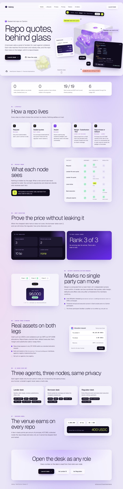
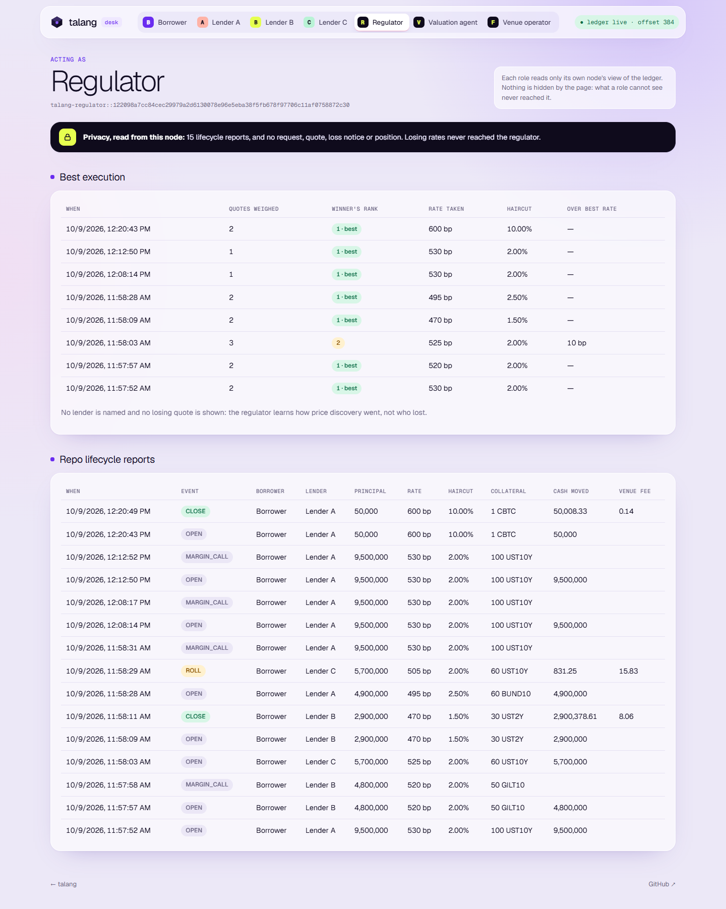

# Talang

**Live desk:** https://talang-desk.vercel.app/desk (read-only, live DevNet data) · **Landing:** https://talang-desk.vercel.app
**Pitch video:** [YouTube](https://youtu.be/gQlWB3Taq6g) · [media/talang-pitch.mp4](media/talang-pitch.mp4) (subtitled) · **Desk walkthrough:** [media/talang-desk-captioned.mp4](media/talang-desk-captioned.mp4) · **BitSafe DecMan demo:** [media/decman-demo-captioned.mp4](media/decman-demo-captioned.mp4) · **Deck:** [media/talang-pitch-deck.pdf](media/talang-pitch-deck.pdf)

| Sponsor | What runs, and where the proof is |
|---|---|
| **NODERS DevNet** | `talang-repo` 1.0.0 (package `24fdd6f4…3fc3bb`) vetted on `hackcanton-devnet-3` and seeded; the hosted desk reads it live ([run log](docs/evidence/devnet-run.log)). The 1.1.0 upgrade (`a3dc67f1…07bc8`) is vetted on `hackcanton-devnet-3` too (uploaded through the NODERS console on 9 October; the console lists it as Vetted, package id matches `devnet/talang-repo-1.1.0.dar`) and runs on the local sandbox, LocalNet and CI. The 1.2.0 upgrade (`5125df18…a3c366`, matches `devnet/talang-repo-1.2.0.dar`) was uploaded through the console on 12 October and is listed as Vetted. 1.2.1 (QA fixes: no double pledge, roll vs allocation expiry, close-out default window) (`e25dd288…f3e45e`, matches `devnet/talang-repo-1.2.1.dar`) was uploaded through the console on 13 October and is listed as Vetted. 1.2.2 (`cea8e352…bf0b2d`, `devnet/talang-repo-1.2.2.dar`: one CIP-0056 allocation backs one repo, `Open` closes its RFQ, a claim after maturity returns the excess) is SCU-checked against 1.1.0, 1.2.0 and 1.2.1 and was uploaded through the console on 13 October; listed as Vetted. A CBTC-collateral repo defaulted there: 0.001 CBTC executed to lender A through the DA Utility registry ([evidence](docs/evidence/cbtc-default-devnet.json)) |
| **CIP-0056 tokens** | A repo with **Canton Coin cash and CBTC collateral** on DevNet, both allocated through their registries and settled at repurchase, 12 of 12 steps ([evidence](docs/evidence/token-repo-amulet-cbtc-devnet.json)); any CIP-0056 instrument by env ([docs/token-legs.md](docs/token-legs.md)). USDCx: not run (no DevNet registry) |
| **BitSafe DecMan** | Valuation committee hosted on 3 participants, in one command: `bash localnet/demo.sh reset`; 1-of-3 refused, 2-of-3 executed, survives one node down ([docs/bitsafe.md](docs/bitsafe.md)); the same flow clicked through DecMan's own UI in the [DecMan demo](media/decman-demo-captioned.mp4). On DevNet the same `GovernanceRules` flow runs with a committee and three pricers on the NODERS participant: 1-of-3 refused, 2-of-3 executed, a repo and a margin call on the committee mark, 8 of 8 steps ([evidence](docs/evidence/bitsafe-governed-marks-devnet.json)); there all four parties sit on one node, so it shows shared control, not distributed hosting |
| **Grofty / CIP-0103** | Run with the live Grofty extension on Canton TestNet ([evidence](docs/evidence/grofty-wallet-testnet.json), [video](media/grofty-wallet.mp4)): the desk connects, two borrower commands are signed in Grofty and accepted by `api/wallet-verify.mjs` (also by the hosted copy), and a 1 CC venue fee prepared by the desk is approved in Grofty and executed on TestNet. The signed Talang commands run on a local Canton ledger, since Grofty's participant cannot host Talang's package |

## Verify in 2 minutes

1. **Live desk, one role at a time** (read-only, NODERS DevNet): [regulator](https://talang-desk.vercel.app/desk?role=regulator) sees lifecycle reports (borrower and winning lender) and best-execution records with no lender named, and no requests or quotes; [lender B](https://talang-desk.vercel.app/desk?role=lenderB) sees its own quotes only; [borrower](https://talang-desk.vercel.app/desk?role=borrower) sees every quote made to it. The same data as JSON: `curl -s -X POST -H 'content-type: application/json' -d '{"role":"regulator"}' https://talang-desk.vercel.app/api/acs`.
2. **Evidence with update ids** (as returned by the participant; there is no public explorer for it): [Canton Coin + CBTC repo on DevNet](docs/evidence/token-repo-amulet-cbtc-devnet.json) (12 steps), [CBTC collateral on DevNet](docs/evidence/cbtc-rail-devnet.json) (7), [CBTC default on DevNet](docs/evidence/cbtc-default-devnet.json) (9), [Grofty on TestNet](docs/evidence/grofty-wallet-testnet.json) (4), [committee on 3 LocalNet nodes](docs/evidence/bitsafe-governed-marks-localnet.json) (8), [one node down, then two](docs/evidence/bitsafe-node-offline-localnet.json) (6).
3. **BitSafe LocalNet, one command** (Docker, Node 20, `daml build --all` once): `bash localnet/demo.sh reset`. Or watch it: [media/decman-demo-captioned.mp4](media/decman-demo-captioned.mp4) (79 s).
4. **Tests**: `cd test && daml test` (58 scripts) and `npm run test:proxy` (53 checks, no network). CI [run 38272515745](https://github.com/PugarHuda/talang/actions/runs/38272515745) (commit `f9e539b`) ran the Daml scripts of that commit (31), then the 41 MCP end-to-end checks, governance and the token rail on a Canton sandbox.

DevNet party ids carry the `tirai-` prefix of the NODERS tenant's earlier project; `parties.json` maps them to the desk roles.

A sealed-bid repo desk on Canton. A borrower asks a panel of lenders for cash
against collateral; each lender's rate and haircut reach the borrower and nobody
else. The quote the borrower takes opens a repo that lives on the ledger until it
is repurchased: margin, substitution, rolls, repurchase and default are enforced by
contract, the price source can be a BitSafe decentralized party, and both legs can
be real Canton Token Standard assets such as USDCx and CBTC.

| Step | Who | What the ledger enforces |
|---|---|---|
| Request | borrower | Only the invited lenders see it, and it carries no rate |
| Quote | lender | Full principal locked behind the quote, as a desk escrow or a CIP-0056 allocation; rivals and the regulator never receive it |
| Award | borrower | Opening leg atomic: collateral pledged, cash delivered, losers refunded unrevealed. Since 1.2.0 `AwardSealed` is nonconsuming and archives the request at the end, so an invited lender is not an informee of the award (the consuming `Award` is kept for the upgrade and refuses) |
| Loss notice | each loser | Told its rank among the quotes weighed, and nothing else: no winning rate, no winner |
| Best execution | regulator | How many quotes were weighed, the winner's rank on rate, the gap to the best rate as a band (0, 1-5, 6-25, >25 bp; an exact gap would give away the best losing rate); no lender named |
| Margin call | lender | Shortfall computed from the valuation agent's mark, refused while the repo is covered, on a mark over an hour old, with under 2 hours to answer, or (1.2.0) for a shortfall below the repo's minimum transfer amount. The borrower cancels a call with a newer mark from the same agent that shows cover (`RefuteMarginCall`) |
| Substitution | borrower, then lender | Swap happens only if the substitute covers what is owed at a fresh mark and (1.2.0) comes from the repo's collateral issuer; the borrower can withdraw an unanswered offer |
| Roll | lender offers, borrower accepts | Interest so far paid now, new rate from today, coverage re-checked at a fresh mark |
| Repurchase | borrower | Principal plus ACT/360 interest to the lender, the venue's fee to the operator, collateral home, change returned |
| Default | lender | After an unanswered call (within a day of its deadline, 1.2.0) or past maturity, the lender keeps collateral worth what is owed and the rest goes back |
| Haircut schedule (1.2.0) | lender signs, borrower sees | Quotes and substitution approvals made through it are refused below the lender's floor for that collateral, or for collateral it does not list |
| Master agreement (1.2.0) | one side offers, the other signs | On an event of default (a repo past maturity, or a call past its deadline) the lender closes out every repo it names under the agreement in one transaction, at fresh marks with no haircut; excess on one repo covers a shortfall on another; one `CloseOutReport` to the regulator |
| Report | regulator | Every lifecycle event of an open repo (a master-agreement close-out as one `CloseOutReport` for its netting set), nothing upstream of it |

## Why Canton for a sealed-bid repo RFQ

| | Public EVM chain | Privacy L2 / Sui-style object chain | Canton |
|---|---|---|---|
| Who sees a lender's rate and haircut | Everyone: calldata and mempool are public | Hidden only behind ZK proofs, encryption or an enclave the desk has to build and keep audited | The borrower who asked; the quote has no other stakeholder, so no other node receives it |
| Opening leg: cash to the borrower, collateral to the lender | Atomic on one chain, with both amounts public | Atomic on its own chain; assets from other issuers arrive through a bridge | One Daml transaction across both legs, including CIP-0056 assets from separate registries (USDCx, CBTC) |
| Regulator view | The same public data as everyone, or an off-chain report | Viewing keys or a separate disclosure channel | `RepoReport` and `BestExecution` contracts with the regulator as observer: lifecycle (winning lender named) and winner's rank, no losing rates, no losing lender named |
| k-of-n governance of marks and lender syndicates | A multisig contract; votes and prices public | A multisig or committee scheme per chain | BitSafe `GovernanceRules` on a decentralized party hosted on several nodes; on LocalNet it still publishes with one of three nodes down, not with two |



The desk is at `/desk` (`?role=lenderB` opens it as a role); the landing page is at `/`.



## What is new in this version

| | Where | Verified |
|---|---|---|
| **CIP-0056 cash and collateral.** Quotes funded by a USDCx (or any registry) `Allocation`; collateral such as CBTC held as an `Allocation` to the lender that stays executable through the claim window. Repurchase unwinds it, default executes it, margin and substitution add or swap allocations. | `daml/Talang.daml` (`Locked`, `SubmitTokenQuote`, `AwardWithTokenCollateral`, `PostTokenMargin`, `ProposeTokenSubstitution`) | 7 scripts in `test/daml/TokenTest.daml` against a registry that implements the real Splice `Allocation` interface |
| **Token repurchase as a wallet request.** `RepurchaseNotice` implements the standard `AllocationRequest`, so any CIP-0056 wallet shows "allocate 50,125 USDCx to the lender and 2.08 to the venue". A notice is good for the day it names. | `RepurchaseNotice`, `VenueAgreement` | `tokenLifecycle`, `staleNotice` |
| **BitSafe Decentralization Manager.** Marks published by a k-of-n valuation committee; a lender that is a k-of-n syndicate quotes, calls margin, defaults and offers rolls only after a threshold of its members confirms. Uses BitSafe's released `governance-action-v1` and `governance-core-v1` DARs unchanged. | `daml/TalangGovernance.daml` | `test/daml/GovernanceTest.daml`; on a Canton participant by `scripts/governance.mjs` ([evidence](docs/evidence/bitsafe-governed-marks-local-sandbox.json)); live-price oracle, one pricer per exchange, by `scripts/oracle.mjs` ([evidence](docs/evidence/oracle-local-sandbox.json)) |
| **Best execution and loss notices.** | `award` in `daml/Talang.daml` | `bestExecution`, and from every node in `npm run e2e:mcp` |
| **Venue fee**, bp per annum ACT/360, inside repurchase and roll. | `Venue`, `Repurchase`, `Roll` | `venueFeeOnRepurchase`, `tokenLifecycle` |
| **Rolls.** | `RollOffer`, `Roll` | `rollToNewRate`, `rollRefusals` |
| **Three MCP desks**: lender, borrower, regulator. | `mcp/server.mjs` | 41 checks in `scripts/e2e-mcp.mjs` on a Canton participant |
| **talang-repo 1.2.2 (SCU upgrade of 1.2.1).** A CIP-0056 collateral allocation names the settlement it pledges to in `settlementRef.cid` (the RFQ, the margin call or the repo), so one allocation can no longer back two repos with the same lender; `Open` archives its RFQ, so a borrower calling it directly closes the request instead of keeping it open for a second repo; `ClaimAfterMaturity` nets at a fresh mark and returns the excess, like default and close-out; a mark needs an instrument; the operator can name the fee instrument; `payOut` refuses rather than skip a leg. Not fixed: `BestExecution` and `LossNotice` are borrower statements and can be created alone (a co-signature would show the winning lender its rank); the regulator reads them against the co-signed OPEN report. | `daml/Talang.daml`, `daml/TalangGovernance.daml` (`ClaimAtMarkMove`), token scripts (`cid` set) | 6 new scripts in `AdversarialTest` |
| **talang-repo 1.2.0 (smart-contract upgrade of 1.1.0).** Minimum transfer amount on `Terms`; lender `HaircutSchedule` (`QuoteWithinSchedule`, `ApproveWithinSchedule`); `MasterAgreement` with `CloseOut` netting and `CloseOutReport`; security fixes: `AwardSealed`, substitute issuer check, `WithdrawSubstitution`, one-hour mark for a call plus `RefuteMarginCall`, one-day default window, best-execution band. The desk drives all of it: a lender signs, revises and withdraws its schedule and quotes through it, the borrower sets a minimum transfer on a request and refutes a call, either side offers a master agreement, the lender closes out and all three sides see the report. | `daml/TalangAgreements.daml`, `daml/Talang.daml`, `web/app.js` | `AgreementsTest`, `SecurityTest`; in the browser by `npm run qa:desk` (10 checks on 1.2.0) and its `close-out` run |

## Build and test

```
daml build --all
cd test && daml test        # 58 scripts: core, desk, CIP-0056 tokens, BitSafe governance, 1.2.0 agreements, adversarial QA and 1.2.2 fixes
npm run test:proxy          # hosted read-only API, no network or credentials
```

## Tests

Counts are what was observed, with where. "CI" is GitHub Actions run
[38272515745](https://github.com/PugarHuda/talang/actions/runs/38272515745) (commit
`f9e539b`, talang-repo 1.2.0, local Canton sandbox 3.4.11).

| Suite | Covers | Result | Where observed |
|---|---|---|---|
| `daml test` (`test/daml/`) | Core lifecycle, default paths and refusals (`TalangTest`); venue fee, best execution, rolls (`DeskTest`); CIP-0056 legs against `MockRegistry` (`TokenTest`); BitSafe valuation committee and lender syndicate on the real `GovernanceRules` (`GovernanceTest`); 1.1.0 rules: 2-hour minimum margin window, default keeps only what is owed and returns the excess (`marginWindowFloor`, `defaultReturnsExcess`, `defaultAcrossPledges`); 1.2.0 fixes (`SecurityTest`) and minimum transfer, haircut schedules, close-out netting (`AgreementsTest`); adversarial QA and the 1.2.1 fixes: authorization, privacy, time edges, arithmetic edges, double pledge, roll vs allocation expiry; 1.2.2 fixes: allocation bound to one repo, direct `Open` closes the RFQ, claim at a mark, blank-instrument mark, fee instrument, `payOut` legs (`AdversarialTest`) | 58 of 58 scripts ok (four are setup fixtures), local run 13 Oct (talang-repo 1.2.2) | In CI |
| `npm run test:proxy` | `api/acs.mjs`, `api/config.mjs` and `api/wallet-verify.mjs` with fetch stubbed (wallet-verify POST only, never reaches the ledger); only POST acs and GET config served, bad roles rejected before the ledger is reached, every ledger call a read scoped to one desk party, no client secret or bearer token in any response, no other file in `api/`; the regulator gets pre-1.2.0 best-execution gaps as a band; 30 identical reads share one ledger read; one IP past its burst gets 429 before the ledger is asked | 53 of 53 checks | Locally on 13 October |
| `npm run e2e:mcp` | Every MCP desk end to end: tool lists per role, privacy read from each node, award, roll offered and withdrawn, substitution declined, margin call refused under 2 hours then answered, claim and default refused early, cancel and withdraw unlock cash, repurchase, regulator exposure | 41 of 41 checks | In CI |
| `npm run qa:desk` | Playwright through every role and every desk button, outcomes re-read from each node; refusals (short haircut, stale mark, early default, bad inputs, double click), privacy in page and API, read-only mode, server hardening, accessible names, 390 px layout | 39 of 39 checks | Local sandbox, talang-repo 1.2.2, 13 October, on the same sandbox after `e2e:mcp` (41 of 41); the 1.2.0 flows (haircut schedule, minimum transfer refusal, margin refutation, substitution withdraw, master agreement, close-out) added on 12 October (commit `298ae6d`) |
| `node scripts/qa-real-user.mjs` | A person at the desk, clicks and typing only (no `/api/submit`): lifecycle in every role, privacy in the page and on the wire, bad input, schedule, master agreement, UX (refresh, back button, repaint, fast role switching, keyboard, 390 px); `late` phase two hours on: default and close-out netting | 38 of 38 checks (phase 1) | Local sandbox, talang-repo 1.2.2, 13 October, after `e2e:mcp` and `qa:desk` on the same sandbox |
| `scripts/cbtc-rail.mjs` | Real CBTC on DevNet: the faucet's transfer offer accepted through the registry, CBTC allocated through the registry's `AllocationFactory` as repo collateral, award, repurchase cancelling the allocation | 7 of 7 steps | [NODERS DevNet](docs/evidence/cbtc-rail-devnet.json) |
| `scripts/token-repo.mjs` (`PRESET=cc-cash,cbtc-collateral`) | Both legs real tokens on DevNet: Canton Coin tapped, the lender's quote funded by an Amulet allocation through the Scan registry, CBTC collateral allocated through the DA Utility registry, award, repurchase notice, the borrower's Amulet allocation for the 50.01 due, settlement with CBTC home | 12 of 12 steps | [NODERS DevNet](docs/evidence/token-repo-amulet-cbtc-devnet.json) |
| `npm run governance` | BitSafe 2-of-3 marks: 1-of-3 refused, 2-of-3 executed, margin call on one pricer's own mark refused | 8 of 8 steps (2 expected refusals) | [local sandbox](docs/evidence/bitsafe-governed-marks-local-sandbox.json); [DecMan LocalNet](docs/evidence/bitsafe-governed-marks-localnet.json), 8 of 8 steps |
| `scripts/localnet-offline.mjs` | Committee on three LocalNet participants: publishes with one node stopped, cannot with two | 6 of 6 steps (1 expected refusal) | [DecMan LocalNet](docs/evidence/bitsafe-node-offline-localnet.json) |
| `npm run token-rail` | USDCx-funded sealed quotes, CBTC collateral as an allocation, repurchase read as an `AllocationRequest`, settlement | 8 of 8 steps | [local sandbox](docs/evidence/cip56-token-repo-local-sandbox.json), and in CI |
| `npm run oracle` | Committee of three exchange pricers: honest round published, manipulated round refused, Treasury notes priced | 4 of 4 steps (1 expected refusal) | [local sandbox](docs/evidence/oracle-local-sandbox.json) |
| `scripts/cbtc-default.mjs` | CBTC-collateral repo defaulted on DevNet: phase 1 (RFQ, award on a CBTC allocation, stress mark, margin call), phase 2 (lender A defaults, the CBTC allocation executed to lender A through the DA Utility registry) | 9 of 9 steps | [NODERS DevNet](docs/evidence/cbtc-default-devnet.json), phase 1 on 9 October, phase 2 on 12 October (offset 3209860) |
| `scripts/grofty-e2e.mjs` | Live Grofty extension (TestNet build), driven by Playwright: connect, two desk commands signed in Grofty and verified, 1 CC venue fee executed on TestNet | 4 steps | [Canton TestNet + local sandbox](docs/evidence/grofty-wallet-testnet.json), 12 October |

## Run the whole stack locally, no credentials

```
daml sandbox --json-api-port 7575 --dar .daml/dist/talang-repo-1.2.2.dar --wall-clock-time
npm ci
npm run local                               # allocate the desk's parties on the sandbox
ENV_FILE=.env.local npm run seed            # one repo in every state
ENV_FILE=.env.local npm run e2e:mcp         # every MCP desk, 41 checks, privacy read from each node
ENV_FILE=.env.local npm run governance      # BitSafe 2-of-3 marks through GovernanceRules
ENV_FILE=.env.local npm run token-rail      # USDCx quotes, CBTC collateral, repurchase as an AllocationRequest (needs `daml build --all`)
ENV_FILE=.env.local npm run desk            # http://localhost:8090 (landing), /desk?role=lenderB
```

CI runs exactly this on every push (`.github/workflows/ci.yml`).

## Run the desk on DevNet

Put the M2M client settings in `.env.noders` (gitignored), then `npm run upload`
(talang-repo and BitSafe's governance DARs), `npm run seed`, `npm run e2e:mcp`,
`npm run governance` and `npm run desk`, as above without `ENV_FILE`.
`npm run marks` re-publishes fresh marks; the contract refuses marks older than 24h.
On the NODERS participant the app user may not upload packages (403, in the
[run log](docs/evidence/devnet-run.log)), so the DARs go in through the NODERS console.

`talang-repo` (1.0.0, then 1.1.0 and 1.2.0 as smart-contract upgrades) is a new package name: the `talang-desk` 0.1.0
package from the first commits was uploaded to the NODERS DevNet participant, and this
version changes template shapes in ways a smart-contract upgrade may not.

The hosted copy is read-only: `api/` exposes reads only, scoped to this desk's
parties, and has no submit endpoint.
1.2.0 is vetted on the NODERS participant since 12 October. On a node that does not vet it, the desk's read
leaves out the 1.2.0 templates (schedules, master agreements, close-outs) and shows the rest (`deskAcs` in `lib/ledger.mjs`).

### CBTC default on DevNet (two phases)

`scripts/cbtc-default.mjs` runs inside a Vercel build of the `talang` project (the DevNet
credentials live there), from a checkout whose `vercel.json` has
`"buildCommand": "node scripts/devnet-ci.mjs"` and with `devnet/*.dar` present:

```sh
# Phase 1: RFQ, award on CBTC collateral, stress mark, margin call (respondBy = now + 2 h 2 min)
vercel deploy --prod --yes --build-env TALANG_DEVNET_CI=1 --build-env DEVNET_STEPS=cbtc-default --build-env PHASE=open
curl -s https://talang-desk.vercel.app/evidence/cbtc-default-devnet.json > docs/evidence/cbtc-default-devnet.json
git add docs/evidence/cbtc-default-devnet.json && git commit -m "cbtc-default phase 1 on DevNet" && git push

# Phase 2, from a commit with that evidence file: lender A defaults, CBTC executed to lender A
vercel deploy --prod --yes --build-env TALANG_DEVNET_CI=1 --build-env DEVNET_STEPS=cbtc-default --build-env PHASE=default
curl -s https://talang-desk.vercel.app/evidence/cbtc-default-devnet.json > docs/evidence/cbtc-default-devnet.json
```

Timing: phase 2 must run **after** respondBy (else it exits 3 and names the minutes
left) and, under talang-repo 1.2.0 (vetted since 12 October), **within 24 h of respondBy** (`defaultWindow`;
1.1.0 has no such limit; the 12 October phase 2 ran before 1.2.0 was vetted, three days after respondBy). Missed it: run phase 1 again; phase 2 takes the newest due call.
The CBTC allocation's `settleBefore` is 6 days after phase 1, so it outlives the window.
Phase 2 reads every id from the ledger (the call, its trade, the allocation), not from
the evidence file. Lender A is no stakeholder of the registry's `DvpLegAllocation`, so
phase 2 passes it as a disclosed contract fetched as the borrower; without that the
submit fails with `CONTRACT_NOT_FOUND` (the first phase 2 attempt, 12 October). Offline check of phase 2:
`node scripts/test-cbtc-default.mjs`.

Last run: phase 1 on 9 October (1.1.0), phase 2 on 12 October from `c94758a`: 0.001 CBTC
executed to lender A through the registry, allocation gone, offset 3209860
([evidence](docs/evidence/cbtc-default-devnet.json)).

## AI desk agents (MCP)

`mcp/server.mjs` puts Claude at one desk. It reads only that party's node, so it is
bound by the same privacy as a human: a lender's agent never sees a rival's rate,
and the regulator's agent sees reports and nothing upstream.

| Role | Tools |
|---|---|
| `lenderA` / `lenderB` / `lenderC` | `portfolio`, `open_requests`, `quote`, `call_margin`, `review_substitution` (`approve` or `decline` only), `offer_roll`, `withdraw_quote`, `withdraw_roll`, `declare_default`, `claim_collateral`, `loss_history`, `publish_haircut_schedule`, `master_agreements`, `propose_master`, `sign_master`, `close_out`, `privacy_check` |
| `borrower` | `quotes` (ranked, with coverage), `award` (`"best"` takes the cheapest covered quote), `book` (owed today incl. venue fee), `request_repo`, `cancel_request`, `post_margin`, `propose_substitution`, `repurchase`, `accept_roll`, `master_agreements`, `propose_master`, `sign_master`, `privacy_check` |
| `regulator` | `lifecycle`, `exposure`, `best_execution`, `close_outs`, `privacy_check` |

Haircut percentages go to the ledger as 10-place decimals. Text in a tool result was
written by other parties, so anything beyond a short plain token is withheld, and each
agent is told to treat ledger values as data. Marks count only from the desk's valuation
agent or committee, here and on the desk (`web/app.js`).

```json
{ "mcpServers": { "talang-borrower": {
  "command": "node", "args": ["<repo>/mcp/server.mjs"], "env": { "TALANG_ROLE": "borrower" } } } }
```

## Sponsor integrations

| | Status |
|---|---|
| **NODERS DevNet / NaaS** | `talang-desk` 0.1.0 was uploaded to the HackCanton DevNet participant and driven through the desk on 3 October (commit `900da46`; package `237ad836995110225ea8cc6337f8af63d2ed3625d6ee8a5421644b154f78194b`, vetted on participant `hackcanton-devnet-3` since 3 October per the NODERS console); no update ids were recorded for that run. `talang-repo` 1.0.0 (package `24fdd6f484e99f2f5d3c2b84f6e7fdd706ee5eeffed214023347c38bcd3fc3bb`) was uploaded through the NODERS console on 9 October and is vetted on `hackcanton-devnet-3`; the seed ran there from a Vercel build (`scripts/devnet-ci.mjs`), so the hosted desk reads live DevNet repos, margin calls, substitutions, loss notices and best-execution records ([run log](docs/evidence/devnet-run.log)). The 1.1.0 upgrade (`a3dc67f1…07bc8`) was uploaded through the console on 9 October and the 1.2.0 upgrade (`5125df18…a3c366`) on 12 October; the console lists both as Vetted (no update ids: vetting is a console action). A CBTC-collateral repo ran to default there in two phases (9 and 12 October): 0.001 CBTC executed to lender A through the DA Utility registry ([evidence](docs/evidence/cbtc-default-devnet.json)). On DevNet the app user may not upload packages or grant itself rights (both 403), so lender C and the governance committee's parties were granted act-as by NODERS; the committee flow ran there, 8 of 8 steps ([evidence](docs/evidence/bitsafe-governed-marks-devnet.json)). |
| **BitSafe Decentralization Manager** | Valuation committee and lender syndicate as `GovernableAction`s on BitSafe's own `GovernanceRules`. Threshold refusal and execution proven in Daml scripts and on a participant. Also run on a three-participant DecMan LocalNet: the committee is onboarded through DecMan and hosted on all three nodes; with one node stopped it still publishes, with two stopped it cannot ([docs/bitsafe.md](docs/bitsafe.md#decman-localnet-three-participants), [evidence](docs/evidence/bitsafe-node-offline-localnet.json)). One command: `bash localnet/demo.sh reset`. A mark proposed, confirmed 2 of 3 and executed in DecMan's own UI, with the third node's audit trail: [media/decman-demo-captioned.mp4](media/decman-demo-captioned.mp4). On DevNet: the same `GovernanceRules` flow on the NODERS participant, 8 of 8 steps, with all four parties on one node ([evidence](docs/evidence/bitsafe-governed-marks-devnet.json)). |
| **CIP-0056: USDCx, CBTC, Canton Coin** | Both legs implemented through the standard `Allocation` / `AllocationRequest` interfaces, tested against a registry implementing them, in Daml scripts and on a participant ([evidence](docs/evidence/cip56-token-repo-local-sandbox.json)). **CBTC is run against the live registry on DevNet** ([evidence](docs/evidence/cbtc-rail-devnet.json)): the BitSafe faucet's transfer offer accepted through the DA Utility registry, CBTC allocated through its `AllocationFactory` (choice context and disclosed contracts from the registry's off-ledger API, `lib/registry.mjs`), held as collateral while the desk's USDC funds the loan, and the allocation cancelled through the registry at repurchase. **A CBTC default on DevNet** ([evidence](docs/evidence/cbtc-default-devnet.json)): the allocation executed to lender A through the registry (`execute-transfer`, offset 3209860). **Both legs in real tokens on DevNet** ([evidence](docs/evidence/token-repo-amulet-cbtc-devnet.json)): Canton Coin as cash (DevNet tap, the lender's quote funded by an Amulet allocation through the Scan registry's AllocationFactory) and CBTC as collateral; award, repurchase notice, the borrower's Amulet allocation for the 50.01 due, settlement with Amulet to the lender and CBTC home. Any CIP-0056 instrument can be either leg by env (`scripts/token-repo.mjs`, [docs/token-legs.md](docs/token-legs.md)). USDCx: **not run**; DevNet has no USDCx registry, and the TestNet/MainNet presets are untested. |
| **Grofty Wallet (CIP-0103)** | Grofty signs only standard token operations on its own participant, so Talang does not send its Daml commands through it. Instead the wallet's key **authorises the desk**: a desk role bound to a wallet (`TALANG_WALLET_ROLES`) acts only after the wallet signs a single-use challenge naming the exact command (CIP-0103 `signMessage`); the server checks nonce, signer, Ed25519/P-256 signature and that the key's fingerprint is the party's namespace before submitting (`api/wallet-verify.mjs`). Each signed command leaves a receipt, so a borrower can verify which wallet key sealed a lender's quote while rival lenders see nothing. The venue fee can be paid in USDCx or CC with `prepareExecuteAndWait({receiver, amount, tokenSymbol})` on TestNet or MainNet, network shown on the receipt (`web/wallet.js`, `web/wallet-pay.js`, `web/wallet-receipts.js`). **Run with the live Grofty extension (TestNet build) on 12 October 2026** by `scripts/grofty-e2e.mjs` (Playwright driving the real extension, no stub; [evidence](docs/evidence/grofty-wallet-testnet.json), [captioned video](media/grofty-wallet.mp4), screenshots `docs/img/grofty-*.png`): (1) the dapp-sdk picker finds Grofty, Grofty shows the connection request, the desk reads party `talang-venue::12206e4f…2c49b` on `canton:da-testnet`; (2) the borrower role is bound to that party: `create RepoRFQ` and `AwardSealed` each came back as a challenge, were signed in Grofty's signature request (Ed25519), accepted by the desk and executed (local ledger update ids `122041fb…73ed` at offset 179 and `1220b09a…c285` at offset 182); the hosted `/api/wallet-verify` accepts both signatures (key fingerprint = party namespace) and rejects the same message with one extra character; (3) the desk's venue fee panel paid 1 CC from the wallet with `prepareExecuteAndWait`, approved in Grofty, executed on TestNet: update id `1220e6e35fe978a3e8ff2816cbe2312fd99dcaa2a77617eb83c5e187bf83a7b6ccad`, listed as "Sent −1 CC completed" in Grofty's activity. Limits, as run: the signed Talang commands executed on a local Canton sandbox, not on TestNet (Grofty's participant runs only standard packages, and the desk has no TestNet participant); the fee went to Grofty's QA party `grofty-qa-testnet::1220e869…bfec3f` (the party that funded the wallet) as a stand-in for a venue, because Grofty refuses a transfer to oneself ("Sender and receiver cannot be the same party") and refuses a second wallet for the same email ("Creating or importing another wallet is blocked for this email"); TestNet Scan is not public (403), so the update id is as returned by the wallet. |

## Prior work disclosure

Talang reuses patterns from [Tirai](https://github.com/PugarHuda/tirai) (HackCanton
Season 2): escrow-on-quote, sealed quotes with no observers, regulator reports, the
CIP-0056 allocation settlement and its mock registry. Talang itself is new work for
HackCanton Season 3: the first commit is 2 October 2026, inside the delivery phase
(18 September to 9 October). `git log` is the record.
